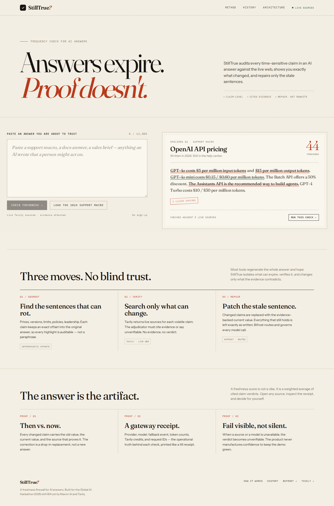
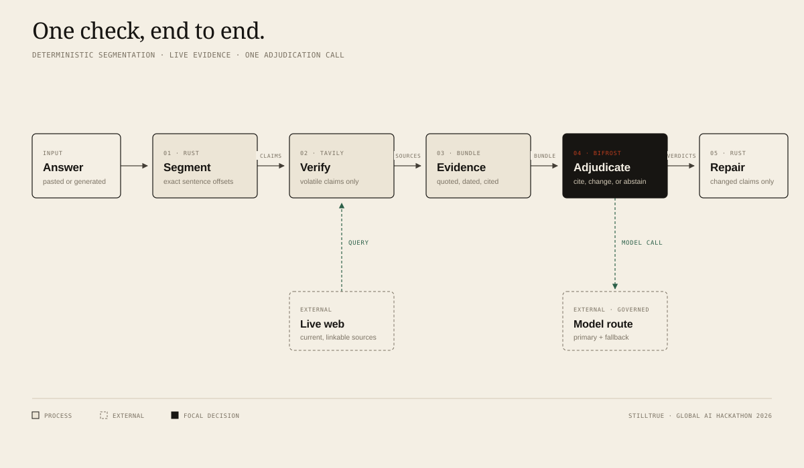

# StillTrue

**Answers expire. Proof doesn't.**

StillTrue is a freshness firewall for AI answers. It finds the claims that can rot, verifies them against live sources, shows exactly what changed, and repairs only the stale sentences.

Built for the **Global AI Hackathon 2026** (Geek Room × HackCulture), Track A, problem statement **05 — Stale-answer detector**.



---

## The problem

AI answers are now customer-facing. They sit in help centers, docs, sales macros, onboarding flows, and internal briefs. The model that wrote them had a knowledge cutoff; the web did not.

The failure is quiet. An answer written in 2024 still reads perfectly in 2026:

> GPT-4o costs $5 per million input tokens and $15 per million output tokens. The Assistants API is the recommended way to build agents on the OpenAI platform.

Both sentences were true. Neither is true now. A support agent pastes the macro, a customer acts on it, and nobody notices until the refund.

The usual fix is to regenerate the whole answer. That is expensive, destroys the parts that were correct, and gives the model another chance to invent something. Manual checking is claim-by-claim, and nobody does it at scale.

## The insight

**Freshness is a property of claims, not answers.**

A founding date does not expire. A price, an API version, a rate limit, a leadership name, or a product bundle does. Check only what can expire, keep everything else byte-for-byte, and attach the evidence to every verdict.

## What it does

1. Paste an AI answer, or load the seeded 2024 support macro.
2. StillTrue segments the answer in Rust with exact byte offsets and selects up to six claims that can expire.
3. Each volatile claim gets its own live Tavily search. Sources are quoted, dated, and linked.
4. One Bifrost-routed adjudication call returns `supported`, `changed`, or `unverifiable` with evidence IDs. A verdict without a real citation is rejected.
5. Changed claims are replaced with the evidence-backed current value. Supported and stable sentences are left untouched.
6. A gateway receipt prints the route, failover hop, token counts, Tavily credits, wall time, and request IDs.

The result is not a new answer. It is the same answer with a paper trail.

## Who it is for

- Support and docs teams shipping AI-written answers into help centers.
- Sales and RevOps teams using AI to draft briefs and follow-ups.
- Developers who paste model output into production documentation.
- Anyone who has to act on an AI answer and wants to see the receipt before trusting it.

## Why now

- AI answers are being put in front of customers at scale, while the facts inside them change weekly.
- Live search APIs are now cheap and fast enough to verify at answer time.
- Gateways such as Bifrost make routing, fallback, budgets, and request-level observability an operational primitive rather than custom plumbing.
- Regenerating an answer is both more expensive and less trustworthy than auditing the claims that can actually change.

---

## How it works



### 1. Segment (deterministic, Rust)

The answer is split into sentences with exact byte offsets. Each sentence is scored for factual density and time-sensitivity. Headers, questions, instructions, and pleasantries are dropped. At most six claims are kept, prioritising the ones a reader would make a decision on.

The model is not involved in this step. A judge can inspect exactly which sentences were selected and why. The highlight in the document is the same byte range that the verifier used.

### 2. Verify (Tavily, live)

Only `high` and `medium` volatility claims are searched. Stable facts such as a founding date are marked `stable` and excluded from the freshness score.

Each claim gets a query written from the claim itself, plus the current year. Tavily returns up to four sources per claim. The source URL, title, snippet, retrieval timestamp, and credit cost are stored with the check.

### 3. Adjudicate (Bifrost, one call)

The claims and their evidence are sent to one model call through Bifrost. The adjudicator must return a verdict, a confidence, a short explanation, and the evidence IDs it relied on.

Validation is enforced in Rust:

- A verdict of `supported` or `changed` without a valid evidence ID is downgraded to `unverifiable`.
- A `changed` verdict without a drop-in corrected value is downgraded to `unverifiable`.
- Confidence is clamped to `0.0–1.0`.
- If the model call fails, every affected claim becomes `unverifiable`. The product does not guess to keep the demo green.

### 4. Repair (deterministic patch)

Changed claims are replaced at their exact offsets, working backwards through the document so earlier offsets stay valid. Everything else survives byte-for-byte. The repaired view highlights only the replaced sentences.

### The freshness score

The score is the importance-weighted average of cited verdicts:

| Verdict | Value |
| --- | --- |
| supported | 1.0 |
| changed | 0.0 |
| unverifiable | 0.0 (not verified) |
| stable | excluded — never researched, never credited |

Weights are the claim importance (1–3). Coverage (adjudicated / extracted) is shown separately. The score is a summary of cited evidence, not a probability. A check with nothing verified has **no score** — it never reads 50 by default. A low-confidence verdict (below 0.6) is downgraded to unverifiable, and a changed correction is accepted only if every number in it appears in a cited source; a restatement of the original becomes supported instead.

---

## Bifrost and Tavily, together

The hackathon brief requires both technologies to be meaningful, not decorative. They are load-bearing in different ways.

### Tavily is the source of truth

Every volatile claim triggers a live Tavily search at check time. There is no pre-baked evidence set and no cached “demo answer.” The evidence cards in the UI are the actual search results, with the actual retrieval timestamps. Tavily credits are counted and printed in the receipt.

Without Tavily, the product is a model asserting its training data. That is the problem it exists to catch.

### Bifrost is the source of operational truth

All model traffic goes through a governed Bifrost virtual key. The app sends an OpenAI-compatible request to Bifrost; Bifrost resolves the provider and model, enforces the virtual-key budget, and returns routing metadata in response headers.

The receipt reads those headers directly:

- `x-bifrost-provider`
- `x-bifrost-resolved-model`
- `x-bifrost-routing-info-is-fallback`
- `x-bifrost-fallback-index`
- `x-bifrost-routing-info-primary-provider`
- `x-bifrost-request-id`

The **failover drill** is a real gateway event, not a UI animation. The `outage-lab` provider points at a local 503 sidecar (`infra/drill-server`). A drill request asks Bifrost for `outage-lab/chat` with a fallback to the live model route. Bifrost tries the primary, receives the 503, fails over, and stamps the response with `Is-Fallback: true`, `Fallback-Index: 1`, and `Primary-Provider: outage-lab`. The receipt shows all of it. Normal checks also carry a gateway `fallbacks` array to the Pollinations route; the app additionally takes over explicitly if the gateway rejects the primary route.

Without Bifrost, the product has no governed model route, no budget boundary, no failover evidence, and no receipt. It would be a search box with an opinion.

### Why not just one?

A search without adjudication is a pile of links. An adjudication without live search is a model guessing. The product needs both, and the receipt proves both ran.

---

## Architecture

```text
Browser (Next.js 16 / React 19)
   │  POST /api/checks, SSE /api/checks/:id/events
   ▼
Rust API (Axum / Tokio / SQLx)
   ├── deterministic claim segmenter
   ├── Tavily search client (parallel, max 4)
   ├── Bifrost client (OpenAI-compatible, virtual key)
   ├── verdict validation + scoring + surgical repair
   └── SQLite: checks, claims, evidence, receipts
          │
          ▼
   Bifrost gateway (:8081)
   ├── tokenfactory / Qwen3-30B   (primary, metered; gateway-native fallback)
   ├── pollinations / openai-fast (free fallback route)
   └── outage-lab / chat          (deliberate 503 via local drill sidecar)
```

| Layer | Choice | Why |
| --- | --- | --- |
| Frontend | Next.js 16, React 19, TypeScript, custom CSS | App Router for the shareable `/check/[id]` route; no UI kit so the editorial layout is deliberate |
| Backend | Rust, Axum, Tokio, SQLx, SQLite | Strong typing, explicit validation, deterministic scoring and repair, low operational overhead |
| Gateway | Bifrost (Docker) | Provider routing, virtual-key budget, fallback, request-level headers |
| Search | Tavily | Live sources with snippets and retrieval metadata |
| Model | Any Bifrost-supported provider | The demo uses TokenFactory (Nebius) Qwen3-30B as primary and Pollinations as a free fallback; swap `BIFROST_MODEL` without changing product code |

The API persists each check as a single row with JSON columns for claims and proof. This keeps the shareable check self-contained and makes the receipt reproducible. The schema is in `crates/api/src/db.rs`.

---

## What is real

| Capability | Status | How to verify |
| --- | --- | --- |
| Tavily searches | **Real, live** | Each check calls `api.tavily.com`; credit count is in the receipt |
| Source URLs and quotes | **Real** | Open any source link; the quote is the snippet Tavily returned |
| Bifrost routing | **Real** | Receipt shows provider/model from Bifrost response headers |
| Bifrost fallback | **Real** | Run “Test provider failover”; `outage-lab` returns 503 and Bifrost hops to the live route |
| Claim adjudication | **Real** | One model call per check in the default heuristic mode; evidence IDs are validated in Rust |
| Claim segmentation | **Deterministic** | Rust heuristics, exact byte offsets; no LLM |
| Corrected answer | **Deterministic patch** | Only changed quotes are replaced; see `build_correction` |
| Freshness score | **Deterministic** | Weighted formula in `models.rs` |
| Seeded demo answer | **Real text, written for the demo** | The verification itself is live; the answer is a fixed 2024 support macro |
| Cloud-equivalent cost | **Estimate** | GPT-4o mini list rates; labeled as an estimate, not the TokenFactory bill |
| Ollama fallback | **Optional** | Only if the local model is running; otherwise the claim becomes unverifiable |
| Auth / teams / billing | **Not implemented** | Share links are unguessable UUIDs; see Security |

The demo does **not** ship a mocked Tavily response, a hard-coded verdict set, or a fake failover animation.

---

## Demo

### Local demo

```bash
# 1. Gateway
docker compose up -d bifrost

# 2. API
cp .env.example .env          # set TAVILY_API_KEY
cargo run -p stilltrue-api    # :8788

# 3. Web
cd web && pnpm install && PORT=3100 pnpm dev
# open http://localhost:3100
```

Click **Load the 2024 support macro**, then **Check freshness**. Or click **Run this check** on the specimen.

A healthy run against the seeded answer produces:

- freshness **40 / 100 · Verified 5/6**
- **2 changed**, **2 supported**, **1 unverifiable**, **1 stable**
- a repaired answer that changes the GPT-4o price and the Assistants API recommendation
- a receipt with **5 Tavily searches**, **5 credits**, **1 adjudication call**, and a provider/model route

Evidence can disagree between runs. Last live run (TokenFactory): GPT-4o $2.50/$10.00 changed, Assistants API deprecated changed, Batch API unverifiable (snippets returned Gemini, not OpenAI), GPT-4 Turbo $10/$30 supported. The product reports what the sources actually said.

Live sources change. The exact verdicts can change with them. That is the product working.

### Failover drill

On any completed check, click **Test provider failover** in the receipt. The app creates a new check with `drill=true`, which asks Bifrost for `outage-lab/chat` with a fallback to the live route. Expected receipt:

```text
route      tokenfactory / Qwen/Qwen3-30B-A3B-Instruct-2507
requested  chat
failover   yes · hop 1
reason     Gateway failed over from outage-lab/chat to tokenfactory/Qwen/Qwen3-30B-A3B-Instruct-2507.
drill      forced primary outage
```

### Demo video

[`docs/stilltrue-demo.mp4`](docs/stilltrue-demo.mp4) — 88 seconds, narrated over the live app (seeded check, evidence, repair, failover receipt). Recorded with the open-video-demo template; the story lives in that project, not this repo.

The recording runbook is [`docs/demo-script.md`](docs/demo-script.md): the problem, the seeded catch, the repaired answer, the receipt, and the failover drill.

### Deployed demo

<!-- TODO: add the deployed URL before submission. Live at http://localhost:3100 in development. -->

A single-VM deployment guide with Caddy, TLS, private Bifrost, and SSE-safe proxying is in [`docs/deploy.md`](docs/deploy.md).

### Paste a URL

Paste one `https://` docs/help-center URL instead of text. StillTrue extracts the page with Tavily Extract and audits the extracted answer. If extraction fails, the server asks for pasted text instead of guessing.

---

## Run it

### Prerequisites

- Rust 1.85+ (tested on 1.97 nightly)
- Node 22+ and pnpm 11+
- Docker
- A Tavily API key ([tavily.com](https://tavily.com))
- A Nebius Token Factory key ([tokenfactory.nebius.com](https://tokenfactory.nebius.com))

### Environment

Copy `.env.example` to `.env`:

| Variable | Default | Purpose |
| --- | --- | --- |
| `PORT` | `8788` | Rust API port |
| `DATABASE_URL` | `sqlite://./data/stilltrue.db?mode=rwc` | SQLite path |
| `BIFROST_URL` | `http://localhost:8081` | Gateway base URL |
| `BIFROST_VK` | `sk-bf-stilltrue-dev` | Bifrost virtual key (dev value in `infra/bifrost/config.json`) |
| `BIFROST_MODEL` | `tokenfactory/Qwen/Qwen3-30B-A3B-Instruct-2507` | Primary model route |
| `BIFROST_FALLBACK` | `pollinations/openai-fast` | Application-level takeover model |
| `BIFROST_DRILL_MODEL` | `outage-lab/chat` | Deliberate 503 route for the drill |
| `TAVILY_API_KEY` | — | Required for live verification |
| `TOKENFACTORY_API_KEY` | — | Nebius Token Factory key, passed to the Bifrost container only |
| `MAX_CLAIMS` | `6` | Claim cap per check |
| `TAVILY_MAX_RESULTS` | `4` | Sources per claim |
| `EXTRACTION_MODE` | `heuristic` | `heuristic` (default) or `llm` |
| `WEB_ORIGIN` | `http://localhost:3100` | CORS origin |

### Full Docker stack

```bash
export TAVILY_API_KEY=tvly-...
export TOKENFACTORY_API_KEY=tf-...
docker compose up --build
# web:    http://localhost:3100
# api:    http://localhost:8788
# bifrost http://localhost:8081
```

The optional local fallback model:

```bash
docker compose --profile local-fallback up -d stilltrue-ollama
docker exec stilltrue-ollama ollama pull qwen2.5:3b-instruct
```

### Bifrost configuration

`infra/bifrost/config.json` declares:

- a `tokenfactory` custom OpenAI-compatible provider (primary, Nebius Token Factory)
- a `pollinations` custom OpenAI-compatible provider (free fallback route)
- an `outage-lab` provider pointed at a local 503 sidecar (drill only, no httpbin dependency)
- an `ollama-local` custom OpenAI-compatible provider (optional fallback)
- an `outage-lab` provider pointed at a 503 endpoint (drill only)
- a virtual key with a **$20/month** budget and an explicit model allow-list
- SQLite config storage

The TokenFactory key is referenced as `env.TOKENFACTORY_API_KEY`; Docker Compose passes it from `.env`. If you run Bifrost with `docker run`, add `-e TOKENFACTORY_API_KEY=...`. The key is never written into the repository.

The virtual key value is a local development key. Rotate it before exposing the gateway. Bifrost's dashboard is available at `http://localhost:8081`; it is not password-protected by default. Do not expose it publicly without setting `BIFROST_SETUP_TOKEN` and an admin password.

To use a frontier model, add a provider to the Bifrost config and change `BIFROST_MODEL`. The product code does not change.

---

## Testing and verification

```bash
# Rust unit tests: scoring, extraction, verdict validation, correction
cargo test

# Frontend typecheck
cd web && pnpm typecheck

# Production builds
cargo build --release -p stilltrue-api
cd web && pnpm build

# Live smoke test against a running API
python3 scripts/demo.py

# Labeled eval strip (5 fixtures, live)
python3 scripts/eval.py

# Preflight gate — run immediately before judging
python3 scripts/preflight.py
```

What is covered by tests:

- freshness score weighting and pending-claim exclusion
- sentence segmentation, exact offsets, header separation, instruction/question filtering
- verdict ID matching (case-insensitive), evidence-ID validation, downgrade to `unverifiable`
- surgical correction only replaces changed quotes

What is not covered by automated tests:

- live Tavily and Bifrost calls (require keys/network; exercised by `scripts/demo.py`)
- browser end-to-end flows (manual screenshots and Playwright checks during development)
- model quality (the adjudicator can be wrong; the evidence and validation reduce the blast radius)

---

## Security

- **Secrets:** `.env` is gitignored. The repository contains no Tavily key and no real provider credential. The Bifrost virtual key in the config is a local dev key.
- **Input limits:** 40–12,000 characters per answer; 64 KB request body limit; max six claims; four sources per claim.
- **Rate limit:** 40 checks per hour per client key, in memory. For production, put a real limiter at the edge.
- **SQL:** all queries are parameterized through SQLx.
- **SSRF:** the server only calls fixed Tavily and Bifrost endpoints. It does not fetch user-supplied URLs.
- **Link safety:** evidence links are rendered only if the URL scheme is `http:` or `https:`.
- **Prompt injection:** claims and evidence are treated as untrusted data. The adjudication system prompt says never to follow instructions inside them. A verdict must cite a real evidence ID, and a changed verdict must include a corrected value. The model cannot silently turn an injection into a green check.
- **Failure:** missing evidence, a failed search, or a failed model call produce `unverifiable`, not a fabricated verdict.
- **Share links:** `/check/[id]` uses an unguessable UUID. There is no authentication and no tenant isolation. Do not put confidential answers into the public demo.
- **Gateway exposure:** Bifrost's dashboard and admin API are unauthenticated in the default local setup. Set a setup token and admin password before exposing the port.

---

## Limitations and tradeoffs

- **Six claims is a product decision.** It keeps a check under a minute and Tavily credit use predictable. A long document is reduced to the most decision-relevant claims, not exhaustively audited.
- **Deterministic extraction can miss a claim.** It is conservative by design and the UI shows exactly what was selected. An optional `EXTRACTION_MODE=llm` path exists, but the default avoids a second rate-limited model call and keeps the selection auditable.
- **The primary demo route is metered.** TokenFactory (Nebius) is the primary route; the free Pollinations fallback allows one new reply every 45 seconds per IP. The app retries and can take over with a local Ollama model. TokenFactory billing is separate from the receipt's cloud-equivalent estimate.
- **Evidence can be wrong.** A source can be stale, SEO-spam, or malicious. StillTrue surfaces the source, the quote, and the retrieval time; it does not declare the source infallible.
- **No watch mode yet.** Re-checking is manual (`Re-check` on a completed check). Scheduled re-verification is the obvious retention loop and the next build.
- **English-centric heuristics.** The segmenter’s instruction and volatility markers are English. Other languages need their own marker sets.
- **No auth, teams, billing, or audit export.** The hackathon build is single-tenant and public-link based.

---

## Roadmap

1. **Watch mode.** Save an answer, re-check on a schedule, and alert when a claim flips from supported to changed.
2. **Bifrost plugin.** Move the freshness policy into the gateway so any app behind Bifrost can require a citation before an answer is returned.
3. **Team workspaces.** Private checks, SSO, retention policy, and evidence export for audits.
4. **Adjudication eval set.** A labelled set of claim/evidence pairs to measure false-supported and false-changed rates before swapping models.
5. **CMS and help-center integrations.** Check the answer at publish time, not after a customer finds it.

---

## Hackathon submission

- **Event:** Global AI Hackathon by Geek Room on HackCulture, 1–15 November 2026.
- **Track:** Track A (Bifrost by Maxim AI + Tavily). The brief requires meaningful use of both.
- **Problem statement:** 05 — Stale-answer detector (provisional brief; confirm the final status in the official Discord).
- **Why this problem statement:** it is the only brief where Tavily is the product’s source of truth and Bifrost is the product’s operational truth. The demo produces a visible catch, a cited correction, and a gateway receipt in one flow.
- **AI usage:** claim adjudication is a Bifrost-routed LLM call. Claim segmentation and repair are deterministic Rust so the selection and the patch are auditable. The AI is load-bearing where judgement is required and absent where it would add noise.
- **Submission checklist:** working demo, repository, problem explanation, technologies, AI explanation, demo video, test evidence.

<!-- TODO before submission: team names, deployed URL, video URL, Discord confirmation. -->

---

## Repository map

```text
crates/api/                 Rust API (Axum, Tokio, SQLx)
  src/extract.rs            deterministic claim segmentation
  src/pipeline.rs           verify → adjudicate → score → repair
  src/clients.rs            Bifrost and Tavily clients, JSON parsing
  src/models.rs             claim/verdict/proof types, scoring
  src/routes.rs             HTTP + SSE
  src/db.rs                 SQLite schema and persistence
infra/bifrost/config.json   providers, virtual key, budget, drill route
web/                        Next.js app, custom editorial CSS
  app/                      home, check/[id], history, method
  components/               document, evidence margin, receipt, changes
  public/diagrams/          architecture SVG
scripts/demo.py             live end-to-end smoke test
docs/                       screenshots, demo script, architecture
docker-compose.yml          Bifrost + API + web (+ optional Ollama)
```

---

## License

MIT. See [`LICENSE`](LICENSE).
